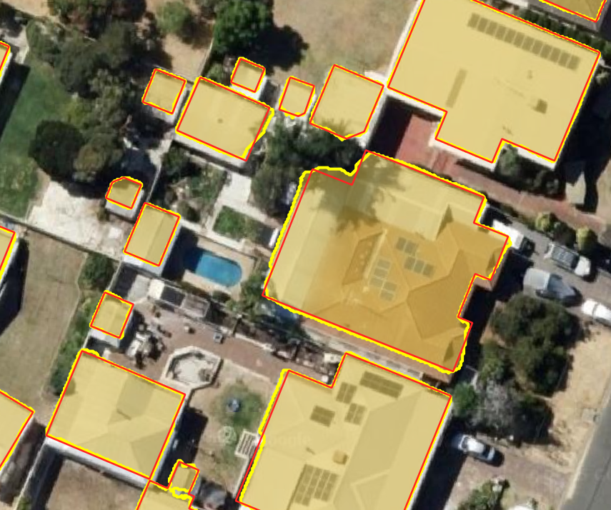
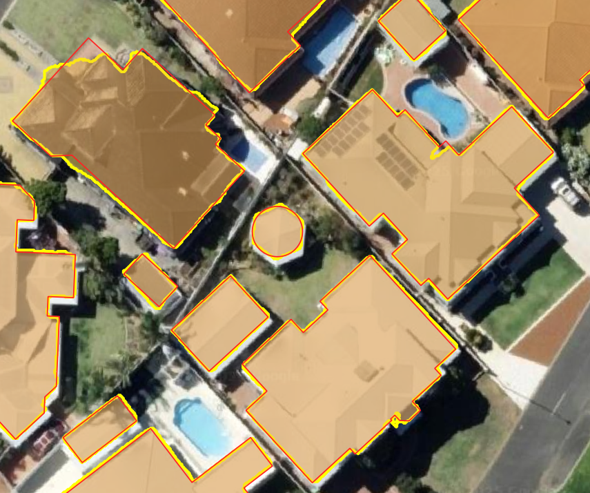

# Building Regulariser

A Python library for regularizing building footprints in geospatial data. This library helps clean up and standardize building polygon geometries by aligning edges to principal directions. Built as an open source alternative to the [ArcGIS Regularize Building Footprint (3D Analyst) tool](https://pro.arcgis.com/en/pro-app/latest/tool-reference/3d-analyst/regularize-building-footprint.htm).

[](https://pypi.org/project/buildingregulariser/)
[](https://anaconda.org/conda-forge/buildingregulariser)
[](https://pepy.tech/project/buildingregulariser)
[](https://pypi.org/project/buildingregulariser/)
[](https://github.com/DPIRD-DMA/Building-Regulariser/actions/workflows/ci.yml)
[](LICENSE)

## Example Results

Before and after regularization:

<div align="center">
  
  
</div>

## Try in Colab

[![Colab_Button]][Link]

[Link]: https://colab.research.google.com/drive/1xeFxpQCAybgbNjmopiHZb7_Tz1lv8k6A?usp=sharing 'Try Building Regulariser In Colab'

[Colab_Button]: https://img.shields.io/badge/Try%20in%20Colab-grey?style=for-the-badge&logo=google-colab

## Overview

Building footprints extracted from remote sensing imagery often contain noise, irregular edges, and geometric inconsistencies. This library provides tools to regularize these footprints by:

- Aligning edges to principal directions (orthogonal and optional 45-degree angles)
- Converting near-rectangular buildings to perfect rectangles
- Converting near-circular buildings to perfect circles
- Simplifying complex polygons while maintaining their essential shape
- Supporting parallel processing for efficient computation with large datasets
- Fine-tune building alignment with neighboring buildings

Inspired by [RS-building-regularization](https://github.com/niecongchong/RS-building-regularization), this library takes a geometric approach to building regularization with improvements for usability and integration with the GeoPandas ecosystem.

## Installation

```bash
pip install buildingregulariser
```
or 
```bash
conda install conda-forge::buildingregulariser
```
or 
```bash
uv add buildingregulariser
```
## Quick Start

```python
import geopandas as gpd
from buildingregulariser import regularize_geodataframe

# Load your building footprints
buildings = gpd.read_file("buildings.gpkg")

# Regularize the building footprints
regularized_buildings = regularize_geodataframe(
    buildings, 
)

# Save the results
regularized_buildings.to_file("regularized_buildings.gpkg")
```

## Features

- **GeoDataFrame Integration**: Works seamlessly with GeoPandas GeoDataFrames
- **Polygon Regularization**: Aligns edges to principal directions
- **45-Degree Support**: Optional alignment to 45-degree angles
- **Align with neighboring buildings**: Align each building with neighboring buildings
- **Circle Detection**: Identifies and converts near-circular shapes to perfect circles
- **Edge Simplification**: Reduces the number of vertices while preserving shape
- **Parallel Processing**: Utilizes multiple CPU cores for faster processing of large datasets
- **Shared Walls**: Optionally output a coverage: no overlaps, and touching buildings share their walls

## Usage Examples

### Basic Regularization

```python
from buildingregulariser import regularize_geodataframe
import geopandas as gpd

buildings = gpd.read_file("buildings.gpkg")
regularized = regularize_geodataframe(buildings)
```

### Fine-tuning Regularization Parameters

```python
regularized = regularize_geodataframe(
    buildings,
    parallel_threshold=2.0,        # Higher values allow less edge alignment
    simplify_tolerance=0.5,        # Controls simplification level, should be 2-3 x the raster pixel size
    allow_45_degree=True,          # Enable 45-degree angles
    allow_circles=True,            # Enable circle detection
    circle_threshold=0.9,          # IOU threshold for circle detection
    neighbor_alignment=True,       # After regularization try to align each building with neighboring buildings
    neighbor_search_distance=100,  # Search distance around each building when looking for neighbors
    neighbor_max_rotation=10,      # Maximum rotation allowed to align with neighbors
)
```

### Touching Buildings (Shared Walls)

```python
regularized = regularize_geodataframe(
    buildings,
    coverage=True,           # no overlaps, touching buildings share one wall
    parallel_threshold=0.4,  # smaller tolerances suit high resolution imagery
    simplify_tolerance=0.3,
)
```

A building left with only a sliver after its overlaps are removed is dropped, so the output can have fewer rows than the input.

## Parameters

- **geodataframe**: Input GeoDataFrame with polygon geometries
- **parallel_threshold**: Distance threshold for handling parallel lines (default: 1.0)
- **target_crs**: Optional CRS (string or `pyproj.CRS`) to reproject the input to before regularization (default: None)
- **simplify**: If True, applies simplification to the geometry (default: True)
- **simplify_tolerance**: Tolerance for simplification (default: 0.5)
- **allow_45_degree**: If True, allows edges to be oriented at 45-degree angles (default: True)
- **diagonal_threshold_reduction**: Used to reduce the chance of diagonal edges being generated, can be from 0 to 22.5 (default: 15.0)
- **allow_circles**: If True, detects and converts near-circular shapes to perfect circles (default: True)
- **circle_threshold**: Intersection over Union (IoU) threshold for circle detection (default: 0.9)
- **num_cores**: Number of CPU cores to use for parallel processing; 0 uses all available cores (default: 0)
- **include_metadata**: Include the main direction, IOU, perimeter and aligned_direction (if used) in output gdf (default: False)
- **neighbor_alignment**: If True, try to align each building with neighboring buildings (default: False)
- **neighbor_search_distance**: The distance to find neighboring buildings (default: 100.0)
- **neighbor_max_rotation**: The maximum allowable rotation to align with neighbors (default: 10)
- **coverage**: If True, the output has no overlaps and touching buildings share their walls (default: False)


## Returns

- A new GeoDataFrame with regularized polygon geometries

## How It Works

1. **Edge Analysis**: Analyzes each polygon to identify principal directions
2. **Edge Orientation**: Aligns edges to be parallel, perpendicular, or at 45 degrees to the main direction
3. **Circle Detection**: Optionally identifies shapes that are nearly circular and converts them to perfect circles
4. **Edge Connection**: Ensures proper connectivity between oriented edges
5. **Angle Enforcement**: Post-processing to ensure target angles are precisely maintained
6. **Neighbor Alignment**: Optionally align each building with neighboring buildings, via rotation around centroid.
7. **Shared Walls**: Optionally (`coverage=True`) simplify all buildings together before step 1, then place them larger first: each smaller building loses its overlap with the ones already placed and fills the narrow gaps to them, so neighbours share one wall.

## License

This project is licensed under the MIT License

## Acknowledgments

This library was inspired by the [RS-building-regularization](https://github.com/niecongchong/RS-building-regularization) project, with improvements for integration with the GeoPandas ecosystem and enhanced regularization algorithms.